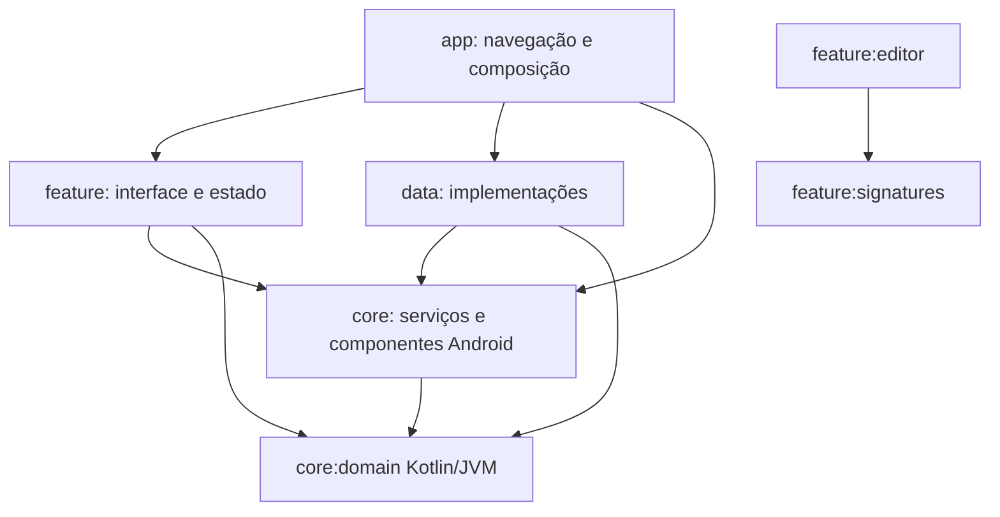

# Arquitetura do Scaniqo

O projeto tem 22 módulos Gradle, registrados em [settings.gradle.kts](../settings.gradle.kts). A divisão separa contratos de negócio, implementações Android, interface de cada funcionalidade e composição do aplicativo. O build incluído [build-logic](../build-logic) centraliza as convenções; ele não faz parte desses 22 módulos.

## Responsabilidades

| Módulo | Responsabilidade |
| --- | --- |
| `:app` | Application, Activity, manifesto final, configuração por variante, navegação, composição das funcionalidades e dos módulos Koin. |
| `:core:domain` | Modelos, contratos de repositórios, geometria PDF e regras independentes de Android. Biblioteca Kotlin/JVM. |
| `:core:resources` | Recursos Android compartilhados por mais de um módulo, sem código de interface ou regras de negócio. |
| `:core:common` | Utilitários Android compartilhados: arquivos, imagens, desenho de texto, localização e formatação. |
| `:core:designsystem` | Tema Compose, tipografia, componentes genéricos, toast, apresentação visual das tags e animação da marca. |
| `:core:security` | Cofre de senhas, sessão de desbloqueio, proteção da janela e componentes de configuração/desbloqueio. |
| `:core:ads` | Integração de anúncios, política de acesso às ferramentas e componentes de anúncios. |
| `:core:document-ui` | Componentes e ações de documentos reutilizados: miniaturas, prévias, metadados, seleção, scanner e entrega de rascunhos. |
| `:core:testing` | Repositórios falsos e fixtures usados pelos testes de diferentes módulos. |
| `:data:documents` | Room, entidades, DAOs, migrações, arquivos locais e repositórios de documentos e tags. |
| `:data:pdf` | Processamento, leitura, composição e exportação PDF, busca no conteúdo, OCR, filtros, preenchimento e certificados. Contém a integração PDFBox. |
| `:data:preferences` | Persistência das preferências do aplicativo, onboarding e valores de preenchimento. |
| `:data:signatures` | Persistência e importação de assinaturas, processamento de imagem e remoção de fundo. |
| `:data:backup` | Arquivos de backup, integração Google Drive, histórico, agendamento e execução de backup. |
| `:feature:library` | Biblioteca de documentos, importação, busca, tags e lixeira. |
| `:feature:editor` | Visualização e edição PDF, páginas, preenchimento, ajustes, qualidade e aplicação de assinaturas. |
| `:feature:signatures` | Biblioteca e criação de assinaturas, desenho, texto, importação, câmera, captura automática e recorte. |
| `:feature:merge` | Seleção, ordenação e fluxo de mesclagem de documentos. |
| `:feature:pdf-tools` | Ferramentas utilitárias PDF e interface de certificados. |
| `:feature:backup` | Estado e interface de backup, histórico e autorização do Drive. |
| `:feature:settings` | Configurações gerais, aparência, idioma e preferências de exportação. |
| `:feature:onboarding` | Apresentação inicial e tutorial reutilizável. |

Os pacotes Kotlin existentes foram mantidos quando possível. O módulo Gradle define o limite de compilação: um pacote chamado `ui.documentCommon` não significa que o código pertença ao aplicativo.

## Direção das dependências

`app` reúne funcionalidades e implementações. As funcionalidades usam contratos do domínio e componentes compartilhados; a camada de dados implementa esses contratos. A interface não depende dos repositórios concretos de `data`.



Regras verificadas pelo plugin `scaniqo.module.boundaries`:

- Nenhum módulo de biblioteca depende de `:app`.
- Módulos `core` não dependem de `data` ou `feature`.
- Módulos `data` não dependem de `feature`.
- Módulos `feature` não dependem de `data`.
- A única dependência entre funcionalidades é `:feature:editor → :feature:signatures`: o editor incorpora o fluxo reutilizável de aquisição e recorte de assinaturas.

Há colaboração entre implementações da camada de dados: `:data:pdf` utiliza o armazenamento local de `:data:documents`, e `:data:backup` utiliza a validação de projetos de `:data:pdf`. Essas dependências permanecem nessa camada e não formam ciclos.

Use `implementation` para detalhes internos e `api` somente quando um tipo da dependência fizer parte da API pública do módulo. Componentes, funções e modelos de implementação ficam `internal`; os testes acompanham o módulo proprietário para continuar acessando esses detalhes.

`:core:testing` deve ser consumido apenas por configurações de teste, como `testImplementation`. O plugin de limites rejeita sua inclusão em dependências de produção.

## Composição e navegação

[AppModule.kt](../app/src/main/java/com/joseleandro/scaniqo/di/AppModule.kt) inclui os módulos Koin declarados por cada camada. Cada módulo registra suas próprias implementações ou ViewModels; o aplicativo conecta o conjunto e fornece integrações da aplicação, como o scanner.

A navegação permanece em `app/src/main/java/com/joseleandro/scaniqo/core/navigation`. As telas recebem eventos e callbacks para operações que atravessam funcionalidades. O aplicativo mantém a coordenação que precisa conhecer ambos os lados:

- `DocumentMergeDestination` conecta a biblioteca, o editor e a mesclagem.
- `DocumentQuickActionsHost` entrega resultados de mesclagem e coordena a escolha do documento para assinar.
- `SettingsDestination` abre o tutorial a partir das configurações e preserva o comportamento de voltar.

A central de ferramentas também pertence ao aplicativo por reunir destinos diferentes. Uma funcionalidade nova deve expor sua entrada e seus eventos; a composição entre funcionalidades deve ser acrescentada ao aplicativo.

## Domínio independente de Android

`:core:domain` usa o plugin `scaniqo.jvm.library`; não aplica o plugin Android e não depende de Compose, Room, recursos `R` ou PDFBox.

As cores das tags são representadas por `Int` ARGB (`TagModel.colorArgb` e `TagColor.argb`), e os ícones por chaves estáveis (`TagIcon.key`). A conversão para `Color`, textos e drawables fica em `TagAppearance.kt`, dentro de `:core:designsystem`. Os mapeamentos das entidades Room pertencem à camada de dados.

A geometria compartilhada entre exportação e prévia está no domínio. Por exemplo, `PdfPageNumberMetrics` fornece os avanços da numeração Helvetica sem carregar PDFBox na interface. Um teste de paridade em `:data:pdf` compara essas medidas com a fonte usada na exportação.

## Recursos e persistência

Cada módulo possui seu namespace Android e os recursos usados exclusivamente por sua responsabilidade. Recursos usados por vários módulos ficam em `:core:resources`. O proprietário é definido por identificador de recurso; arquivos XML com o mesmo nome podem existir em módulos diferentes contendo identificadores distintos.

O código importa o `R` do proprietário. Quando uma tela usa recursos locais e compartilhados, utiliza um alias explícito, como `CoreResourcesR`, para os recursos compartilhados. Ao adicionar ou mover um recurso, mantenha suas traduções e variantes junto do mesmo proprietário.

O aplicativo conserva os recursos e configurações de instalação e inicialização, incluindo launcher, manifesto final e valores de anúncios por variante. Os testes e previews que verificam o launcher e os temas finais permanecem em `:app`.

Os manifestos das bibliotecas declaram os requisitos de sua responsabilidade e são mesclados no aplicativo: a câmera pertence a `:feature:signatures`; as permissões e o serviço de foreground do WorkManager para sincronização pertencem a `:data:backup`; os metadados do SDK de anúncios pertencem a `:core:ads`. Este último fornece um app ID de exemplo para execução isolada dos testes de biblioteca, substituído pelos valores de cada variante em `:app`.

Os schemas Room ficam em [data/documents/schemas](../data/documents/schemas), configurados por `room.schemaDirectory` em `:data:documents`. A modularização não altera o nome do banco, as entidades persistidas ou suas versões. Mudanças futuras no banco devem incluir a migração correspondente, seu schema exportado e testes de compatibilidade.

## Convenções de build

As versões de dependências permanecem em [gradle/libs.versions.toml](../gradle/libs.versions.toml). Os plugins em `build-logic` evitam repetir configuração entre módulos:

| Plugin | Configuração compartilhada |
| --- | --- |
| `scaniqo.android.library` | Biblioteca Android, SDKs, compatibilidade Java, runner instrumentado, testes locais e verificação dos limites. |
| `scaniqo.android.compose` | Compilador Compose, BOM, Material 3, previews e ferramentas de teste Compose. |
| `scaniqo.jvm.library` | Biblioteca Kotlin/JVM, compatibilidade Java, testes e verificação dos limites. |
| `scaniqo.pdfbox.testing` | Assets do PDFBox no classpath dos testes locais que precisam deles. |
| `scaniqo.module.boundaries` | Tarefa `checkModuleBoundaries`, também ligada a `check` e `preBuild` quando presentes. |

Cada módulo declara suas dependências específicas. KSP e Room são aplicados em `:data:documents`; o plugin de serialização é aplicado onde utilizado.

## Validação

Execute os comandos abaixo na raiz do projeto. No Windows, use o wrapper `gradlew.bat`; em outros sistemas, o equivalente é `./gradlew`.

Comece pelos testes dos módulos alterados:

```powershell
.\gradlew.bat :core:domain:test
.\gradlew.bat :feature:signatures:testDebugUnitTest --tests "*SignatureAutoCaptureTest"
.\gradlew.bat :data:pdf:testDebugUnitTest --tests "*PdfPageNumberMetricsParityTest"
.\gradlew.bat :feature:library:testDebugUnitTest
```

Para executar toda a suíte local após uma alteração transversal:

```powershell
.\gradlew.bat testDebugUnitTest :core:domain:test
```

Confira as dependências entre módulos e monte o aplicativo completo:

```powershell
.\gradlew.bat checkModuleBoundaries
.\gradlew.bat :app:assembleDebug
```

Os testes instrumentados pertencem ao módulo da interface testada. Para preparar os APKs de teste de uma funcionalidade e do aplicativo:

```powershell
.\gradlew.bat :feature:signatures:assembleDebugAndroidTest :app:assembleDebugAndroidTest
```

Para executar a suíte instrumentada da funcionalidade, use `:feature:signatures:connectedDebugAndroidTest` com o dispositivo ou emulador de teste disponível.

Testes de carga terminados em `LoadTest` ficam desabilitados por padrão. Para executá-los explicitamente em um módulo:

```powershell
.\gradlew.bat :data:documents:testDebugUnitTest -Pscaniqo.loadTests=true --tests "*LoadTest"
```

Os testes dos plugins de convenção podem ser executados separadamente:

```powershell
.\gradlew.bat -p build-logic test
```

A verificação de limites valida dependências de projeto declaradas no Gradle; ela não substitui a compilação, os testes de comportamento nem a revisão das APIs públicas.
