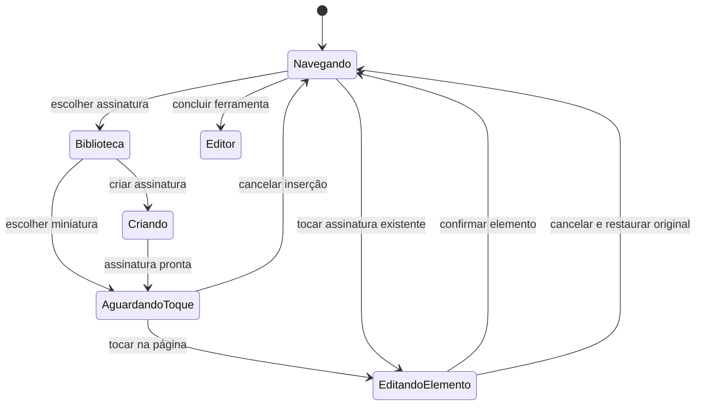

# Plano de ação — usabilidade do editor e das ferramentas do Scaniqo

**Status:** fluxos principais implementados e validados em 24/10/2026. O registro da entrega e os limites da validação estão na seção 20; as seções anteriores preservam o diagnóstico e as decisões originais.

**Revisão de usabilidade posterior:** o [plano v3 de Preencher, Ajustar e Corrigir](plano-preencher-ajustar-corrigir-usabilidade-v3.md) refina os controles dessas ferramentas a partir do feedback após a implementação. Ele tem precedência nas decisões de interação desses fluxos; seu status ainda é proposta.

**Data e base:** 24/10/2026, código atual do módulo `:app`, após as alterações aceitas de ferramentas, compressão, mesclagem e salvamento. Conferir diferenças posteriores antes de executar.

**Relação com o plano anterior:** este documento complementa [o plano de ferramentas e salvamento](plano-ferramentas-ux-animacoes-salvamento.md). A jornada escolher → ajustar → processar → concluir continua válida. As decisões abaixo refinam seleção, edição, precisão e apresentação. O diagnóstico antigo não deve ser usado como retrato do código atual.

**Objetivo:** deixar as ferramentas bonitas, práticas e previsíveis, com acesso rápido às ações frequentes, manipulação precisa sobre o PDF e animações que expliquem o que mudou.

## 1. Entregas solicitadas e prioridades

| Prioridade | Entrega | Resultado perceptível |
|---|---|---|
| P0 | Corrigir a base de Posicionar | Conteúdo alcança topo, esquerda, cantos e posições livres, respeitando a margem escolhida |
| P0 | Garantir fidelidade de novos estilos | Texto e marcas têm a mesma aparência no editor, na prévia e no PDF salvo |
| P1 | Unificar a seleção da mesclagem | Mesma linguagem de origem app/aparelho das demais ferramentas, adaptada à seleção múltipla |
| P1 | Tornar assinatura diretamente editável | Escolher, tocar para posicionar, selecionar na página, ajustar e reeditar com poucos passos |
| P1 | Redesenhar preencher e marcar | Texto, ✓ e ✕ fáceis de escolher; tamanho, cor e estilo acessíveis sem barras congestionadas |
| P1 | Melhorar intervalos de páginas | Seleção compartilhada entre extrair PDF e exportar páginas como imagens, com modos visual e por intervalo |
| P1 | Separar os modos de reordenação | Usuário escolhe Arrastar ou Mover para posição; cada modo apresenta apenas seus controles |
| P2 | Busca na topbar de ferramentas | Lupa abre a barra padrão de pesquisa e libera espaço da listagem inicial |
| P2 | Harmonizar demais controles do editor | Página em destaque, propriedades contextuais, desfazer e confirmação consistentes |
| Transversal | Animação, acessibilidade e restauração | Feedback claro, sem perda de seleção, texto, posição ou precisão |

P0 significa dependência técnica e funcional, não uma justificativa para adiar os ajustes visuais. Busca e seleção podem avançar em paralelo com geometria e renderização.

### Metas objetivas de interação

- Mesclar deve parecer parte da mesma família das telas de escolher PDF, mesmo quando há vários itens.
- Escolher ✓ ou ✕ para inserir: um toque na barra de preenchimento.
- Selecionar um elemento colocado pelo Scaniqo: um toque no elemento, sem procurar uma lista escondida.
- Abrir tamanho, cor ou estilo de texto selecionado: no máximo um toque no controle correspondente; aplicar uma opção não exige abrir outro formulário.
- Assinatura existente na biblioteca: abrir biblioteca → escolher → tocar no local da página.
- Mover uma página diretamente: selecionar miniatura → informar posição final → confirmar, sem digitar a origem novamente.
- Entrar na busca de ferramentas: um toque na lupa, com foco no campo.
- Nenhuma animação deve atrasar a operação, deslocar a página sob o dedo ou modificar o arquivo por conta própria.

## 2. Referências de mercado e como aplicá-las

As referências foram consultadas em documentação pública oficial, não por execução dos aplicativos concorrentes. Os fluxos e medidas propostos neste plano são decisões para o Scaniqo, não uma reprodução integral desses produtos.

| Referência | Comportamento documentado | Aplicação proposta |
|---|---|---|
| [Adobe Acrobat mobile — preencher e assinar](https://helpx.adobe.com/acrobat/mobile/e-sign-documents/fill-sign.html) | Selecionar ferramenta, tocar para inserir texto/marca/assinatura e ajustar o elemento diretamente; controles contextuais de tamanho e cor | Dar prioridade ao documento e às propriedades do item selecionado |
| [Adobe Acrobat Android — editar PDF](https://www.adobe.com/devnet-docs/acrobat/android/en/editpdf.html) | Seleção por toque, ajuste por alças, propriedades de texto e desfazer/refazer | Tornar a edição acessível no próprio objeto e manter ações reversíveis |
| [Xodo mobile — guia oficial](https://xodo.com/blog/how-to-use-xodo-pdf-reader-and-editor-mobile-app) | Organização por miniaturas e reordenação por arraste; ferramentas agrupadas por tarefa | Usar miniaturas reconhecíveis e uma superfície de trabalho por tarefa |
| [Xodo — organização de ferramentas](https://feedback.xodo.com/support/solutions/articles/35000199773-getting-started-xodo-basics) | Barras por contexto e presets de anotação | Separar propriedades frequentes de ajustes avançados |

Preservar a identidade do Scaniqo: tema, cores, ícones, ilustrações e vocabulário. A referência é a facilidade de uso. Não importar menus, planos pagos, contas, sincronização ou funcionalidades que não façam parte do produto.

A documentação da Adobe descreve limitações de edição após achatamento. No Scaniqo, preservar a reedição dos elementos que a receita própria mantém. Não reduzir essa capacidade para imitar outro app. PDFs externos já achatados não passam a ter objetos editáveis automaticamente.

## 3. Diagnóstico atual confirmado no código

| Área | Estado encontrado | Problema a resolver |
|---|---|---|
| Origem comum | `DocumentSourceStep` usa cards com ícone, título, descrição e ilustração compartilhada | É a base visual para as demais entradas |
| Origem da mesclagem | `DocumentMergeSourceStep` tem outra composição, cards horizontais próprios, dimensões e hero diferentes | A diferença de seleção múltipla virou uma diferença visual excessiva |
| Busca de ferramentas | `ToolsHubScreen` mantém um `OutlinedTextField` grande no conteúdo | Ocupa espaço mesmo quando não há intenção de pesquisar |
| Busca padrão existente | `DocumentSearchScreen` já usa campo dentro de `TopAppBar`, limpar, foco e IME Search | Reutilizar esse padrão no catálogo, sem criar outro mecanismo de pesquisa |
| Assinatura | Inserção começa em posição predeterminada; editar uma já colocada depende da lista na biblioteca | Falta o fluxo tocar para posicionar e tocar para reeditar |
| Área de assinatura | Página e controles podem dividir a altura em duas partes de mesmo peso | O documento perde área útil durante ajustes precisos |
| Conclusão da assinatura | O aplicar da rota confirma o rascunho e sai imediatamente | Dificulta inserir ou revisar várias ocorrências na mesma tela |
| Histórico | Há evento `DocumentToolsEvent.Undo`; não há evento de refazer no editor | Refazer exige estado e eventos novos, não apenas outro ícone |
| Preenchimento | `PdfOverlayKind` tem TEXT e CHECKMARK; não tem X | X precisa existir no modelo e nos renderizadores |
| Estilo do texto | Há tamanho, cor, opacidade, alinhamento, autoajuste e quebra; faltam peso, itálico, sublinhado e família | Não basta acrescentar botões à UI |
| Controles de preencher | Tamanho, cores, alinhamento, estilo, aplicar e ações secundárias se repetem em barra e sheet | Hierarquia confusa e excesso de controles concorrentes |
| Fonte/render | `PdfOverlayLayer` usa Helvetica; fallback Unicode e medição usam `ShapedTextLayout` | Novos estilos precisam de resolução comum em todas as camadas |
| Seleção de páginas | Miniaturas e campo textual compartilham uma lista lazy; vazio significa todas no parser, com um booleano separado para nenhuma | Limpar, voltar entre etapas e editar um intervalo não podem alterar a seleção de forma ambígua |
| Formato de imagens | JPG/PNG aparece depois de todas as miniaturas | Pode ficar distante em documentos longos |
| Posicionar | `PageAlignment` só representa CENTER, TOP, BOTTOM, LEFT e RIGHT | Não representa cantos nem deslocamento livre |
| Margem | `PdfPageGeometry.placement` aplica 32 pontos em FIT; em 100% um eixo pode não ter espaço livre | “Topo” não é a borda física; certas escolhas aparentam não fazer nada |
| Reordenação | Campos de movimento direto e arraste ficam ativos juntos | Dois modelos de interação competem na mesma tela |

**Limites conhecidos:** o parser de páginas aceita atualmente documentos de 1 a 100 páginas e texto de até 1.000 caracteres. Preservar esses limites com feedback claro até uma revisão própria de capacidade; não removê-los apenas para a nova UI.

**Ainda a reproduzir:** possíveis conflitos específicos de gestos em zoom, alças difíceis de alcançar e comportamento de teclado em diferentes aparelhos. A limitação das cinco posições é comprovada; não atribuir tudo a zoom ou insets sem reprodução.

## 4. Linguagem de interação comum

### 4.1 Documento em destaque

- Página deve ocupar a maior área útil possível durante editar, assinar, preencher e posicionar.
- Topbar: voltar, título curto/contexto e ação de concluir a ferramenta. Desfazer/refazer acessíveis no contexto de edição.
- Dock inferior compacto: ações da ferramenta ou propriedades do elemento selecionado.
- Painel inferior expansível: propriedades detalhadas, sem substituir a página por uma tela independente.
- Manter no máximo um painel/modal ativo. Biblioteca, cor, tamanho, estilo e seleção de páginas não se empilham.
- Ao abrir um painel, preservar zoom, pan, página atual, seleção e rascunho. Reajustar apenas a área visível necessária para evitar oclusão.
- Com teclado, o dock acompanha o IME; a transformação das coordenadas do PDF não muda.
- Em janelas largas, o mesmo painel pode ocupar uma lateral. O estado não depende de estar em sheet ou painel.
- Em 320 dp e fonte ampliada, usar ações prioritárias mais overflow rotulado; não encolher alvos nem esconder “Concluir”.

### 4.2 Vocabulário e confirmação

| Ação | Significado |
|---|---|
| Selecionar | Escolher arquivo, página ou elemento; não altera o documento por si só |
| Inserir | Criar um elemento no workspace |
| Confirmar elemento | Incorporar o rascunho ao workspace e desmarcar, permanecendo na ferramenta |
| Concluir ferramenta | Resolver o rascunho válido e retornar ao editor |
| Salvar alterações | Persistir o documento existente pelo fluxo já implementado |
| Salvar documento | Cadastrar PDF novo pelo bottom sheet de nome/tag |
| Cancelar edição | Restaurar o elemento/ajuste anterior à edição atual |
| Desfazer | Reverter a última ação confirmada no workspace |

Não exibir “Aplicar”, “Concluir” e “Salvar” como três botões concorrentes para o mesmo passo. O botão do elemento deve ser um check com descrição acessível “Confirmar elemento”; o texto “Concluir” na topbar pertence à ferramenta.

### 4.3 Seleção única e gestos

- Apenas um elemento editável selecionado por vez na página.
- Primeiro toque seleciona; segundo toque em texto, ou ação “Editar texto”, abre edição inline.
- Tocar outro elemento confirma o rascunho válido atual e seleciona o próximo. Rascunho inválido mantém foco e mostra motivo.
- Tocar vazio durante seleção confirma/desmarca; esse mesmo toque não insere outro elemento.
- Após editar um elemento existente, retornar ao modo de inserção visível na barra para criar outro. Exceção explícita: no modo de marcação contínua ✓/✕, cada toque livre insere uma marca e mantém esse modo ativo; não exige desmarcar/reativar entre marcas. Tocar um elemento existente pausa a inserção.
- Um dedo sobre o elemento selecionado move; alças redimensionam; dois dedos navegam no PDF.
- Entrada de um segundo dedo cancela a transformação parcial do elemento antes de iniciar zoom/pan.
- Alças têm área de toque expandida independente da geometria real. Conteúdo pode encostar na borda sem margem artificial para caber o controle.
- Preferir tocar em um elemento para selecioná-lo; long press pode complementar, nunca ser o único caminho.
- Elementos sobrepostos devem ser alcançáveis por ação “Elementos desta página” ou seleção acessível equivalente.
- Uma edição confirmada/gesto concluído corresponde a um passo de desfazer. Não criar histórico por frame ou por movimento mínimo de slider.

### 4.4 Desfazer e refazer

Refazer é uma extensão planejada: o código atual tem Undo, sem Redo. Implementar evento e pilha de refazer em `DocumentToolsViewModel`, junto ao histórico existente, antes de expor a ação.

- Desfazer transfere o estado atual para refazer; refazer reaplica o estado preservando IDs e propriedades.
- Uma nova edição confirmada após desfazer limpa a pilha de refazer. Selecionar item, navegar, abrir painel ou cancelar rascunho não limpa essa pilha.
- Preservar o limite atual de histórico, sem guardar bitmaps adicionais por ação.
- Usar o mesmo ciclo de vida/restauração nas duas pilhas: não restaurar apenas uma metade do histórico nem anunciar que ele sobrevive ao processo se isso não for implementado.
- Sem ação disponível, manter controle desabilitado com semântica acessível.
- Validar editar → desfazer → refazer e editar → desfazer → nova edição, além de cancelamento de gesto e troca de página.

## 5. Seleção de documentos: mesclagem no mesmo padrão

### 5.1 Direção visual

Usar a mesma estrutura de `DocumentSourceStep`: hierarquia de título, margens, hero, formas, cores e cards “Do app” / “Do dispositivo”. A mesclagem muda o texto para plural e acrescenta um resumo de seleção.

- Extrair componentes visuais reais, por exemplo `DocumentSourceLayout` e `DocumentSourceOriginCard`, com slots para ilustração e resumo. Nomes são propostas.
- Preservar controladores separados para seleção única e múltipla. Não transformar toda a importação e mesclagem em um ViewModel universal.
- O hero da mesclagem pode continuar mostrando folhas convergentes, no mesmo espaço e escala visual do hero comum.
- Cards de origem têm o mesmo ícone em superfície tonal, título, descrição curta e resposta de toque das outras ferramentas.
- Em largura/fontScale que exijam uma coluna, ambos os fluxos usam o mesmo critério de adaptação.
- Hero diminui em tela baixa/teclado; seleção e ação principal continuam acessíveis por rolagem.
- Evitar um texto grande de “0 documentos selecionados” e uma segunda explicação vazia. Usar uma instrução curta quando ainda não há seleção.

### 5.2 Fluxo múltiplo

1. Abrir Mesclar → tela de origem comum, sem lista de revisão/ordenação.
2. “Do app” abre biblioteca no mesmo padrão de cabeçalho, busca, linhas, carregamento, vazio e erro.
3. Biblioteca múltipla usa checkboxes discretos, contador e “Pronto”. O modo único continua avançando ao selecionar um item.
4. “Do dispositivo” usa o seletor Android e acrescenta os arquivos válidos à seleção existente.
5. Mostrar resumo compacto das escolhas: miniatura/ícone, nome, origem quando necessária e remover. Lista lazy quando crescer.
6. Rodapé fixo: “Continuar com 2 PDFs”, indisponível abaixo do mínimo, com motivo curto “Escolha pelo menos 2 PDFs”.
7. Continuar abre revisão/ordem. Voltar retorna à seleção mantendo itens e ordem.
8. Aplicar segue o processamento atual e o bottom sheet de nome/tag.

### 5.3 Contratos a preservar

- Misturar arquivos do app e aparelho sem duplicar a mesma referência segundo as regras atuais de merge.
- Cancelar SAF ou biblioteca não limpa escolhas anteriores.
- Uma nova seleção válida é acrescentada uma vez; callback antigo não altera outra sessão.
- Erro de um arquivo não remove os demais; identificar o item e oferecer tentar novamente/remover.
- Documento atual do editor continua obrigatório e não removível no fluxo interno.
- Limites de quantidade, tamanho e proteção continuam sendo os reais do serviço.
- Não confundir o “Pronto” da biblioteca com o “Continuar” entre etapas: primeiro fecha seleção local; segundo abre a revisão.
- Carregamento/erro da biblioteca são tratados dentro do seletor, com estado coerente no host.

**Animações:** feedback de pressão, seleção com check, contador discreto e entrada/remoção dos itens. A ilustração pode reagir ao número de escolhas. Não deslocar automaticamente a lista enquanto a pessoa está marcando vários itens.

**Aceite:** comparar lado a lado origem de mesclar, comprimir e extrair em 390 dp, 320 dp/fontes 1,5× e 2×, modo escuro e paisagem. Devem compartilhar a mesma linguagem, com diferenças explicadas apenas pela seleção múltipla.

## 6. Assinatura: escolher, posicionar e reeditar no próprio PDF

### 6.1 Estados da ferramenta

“Concluir ferramenta” com elemento válido em edição deve confirmar uma vez e retornar ao editor. Se houver texto/estado inválido, explicar e permanecer. Não obrigar dois cliques de confirmação sucessivos.

### 6.2 Biblioteca e criação

- Biblioteca em sheet curto com miniaturas reconhecíveis, nome quando útil, estado selecionado e “Criar assinatura”.
- Não misturar assinaturas disponíveis na biblioteca com assinaturas já colocadas na página.
- Ao escolher uma assinatura, fechar a biblioteca e mostrar “Toque onde deseja assinar”, miniatura escolhida e Cancelar.
- Toque na página define a posição usando a mesma transformação da prévia. Usar centro no ponto tocado e ajustar a caixa inteira aos limites permitidos.
- Alternativa acessível: “Inserir no centro”, seguida de controles de posição.
- Na criação, aproveitar Desenhar, Digitar e Imagem já existentes. A superfície de criação recebe prioridade; nome e reutilização ficam em área secundária.
- “Salvar na biblioteca” deve ter semântica explícita. Auditar `SignaturesViewModel` antes de permitir uso temporário sem biblioteca.
- Não adicionar Rubrica apenas como rótulo: só incluir neste ciclo se puder reutilizar uma assinatura como rubrica sem contrato incompleto. Caso contrário, deixar como evolução posterior.

### 6.3 Edição direta

- Tocar assinatura aplicada seleciona aquele placement pelo ID, com caixa e alças.
- Preservar proporção por padrão ao redimensionar; rotação e ajuste fino disponíveis no painel.
- Barra contextual: **Ajustar**, **Substituir**, check de confirmar e overflow para **Duplicar** / **Excluir**.
- “Ajustar” abre painel compacto com **Tamanho**, **Girar**, **Posição**. Apenas a seção ativa mostra controles detalhados.
- Tamanho: −, valor claro, + e slider acessível; rotação: valor, passos finos e restaurar.
- Posição: botões de deslocamento fino e alinhamento. Não fazer o usuário arrastar como único meio.
- Recorte da imagem fica em ajuste secundário; não deve ocupar espaço permanente.
- Lupa aparece durante precisão perto do dedo e se reposiciona para não encobrir o ponto.
- “Substituir” mantém a ocorrência selecionada e, quando possível, posição/área ocupada; não modifica outras ocorrências nem o arquivo da biblioteca.
- Confirmar mantém a pessoa na ferramenta e permite inserir outra. Concluir na topbar retorna ao editor.
- Cancelar uma edição restaura posição, escala, rotação e recorte anteriores.
- Excluir oferece desfazer; duplicar cria novo ID e deslocamento pequeno ainda dentro da página.
- Assinatura sem propriedades de traço preservadas não deve ganhar uma opção de espessura que apenas distorce bitmap. Cor/espessura da assinatura criada continuam no editor de criação; qualquer recoloração posterior exige suporte explícito e prévia fiel.

### 6.4 Implementação

- Separar escolher recurso, armar inserção e criar placement; `insertSignature()` não deve impor sempre a posição inicial atual.
- Acrescentar hit-test das assinaturas aplicadas em `DocumentSignaturePage`, na ordem visual inversa para selecionar a que está por cima.
- Reusar `editSignature()` / `commitSignature()` e substituição por ID. Não criar uma cópia sobre a anterior ao reeditar.
- Reaproveitar `signatureContainsPointer`, geometria rotacionada, transformações, exclusão seletiva do draft na prévia e ações acessíveis existentes.
- Evitar duas assinaturas visíveis da mesma ocorrência: a original selecionada sai apenas do render da prévia durante o draft, sem ser removida da receita antes da confirmação.
- Evoluir `DocumentSignatureRoute` para distinguir confirmar elemento de sair da ferramenta.
- Conservar recipe, seleção e rascunho na rotação/recriação conforme o padrão atual; não persistir bitmaps grandes no SavedStateHandle.

**Aceite:** inserir duas assinaturas, tocar a primeira, mover/redimensionar/girar, cancelar e verificar restauração; repetir, confirmar, salvar e reabrir com geometria e IDs preservados. Validar também canto, sobreposição, página rotacionada, zoom e erro de renderização.

## 7. Preencher PDF: texto, check e X com estilo acessível

### 7.1 Barra de inserção e seleção

Sem elemento selecionado, apresentar **Texto | ✓ | ✕**, com ícone, rótulo acessível e estado selecionado que não dependa só de cor.

- Texto → tocar na página → campo inline e teclado.
- ✓/✕ → tocar para inserir; modo de marcação pode permanecer ativo para várias caixas.
- Selecionar um elemento existente pausa a inserção. Tocar vazio para desmarcar não cria outra marca no mesmo evento.
- Em marca selecionada, ✓/✕ aparece como controle contextual explícito “Tipo de marca”.
- Converter ✓ em ✕ preserva ID, posição, tamanho, cor e opacidade. Ação é reversível.
- Trocar a ferramenta de inserção não converte silenciosamente um objeto que já estava selecionado.

### 7.2 Organização dos controles

| Contexto | Acesso direto | Painel ou ação secundária |
|---|---|---|
| Texto selecionado | Editar texto, Tamanho, Cor, Estilo, confirmar elemento | Duplicar, excluir, aplicar em outras páginas |
| Marca selecionada | ✓/✕, Tamanho, Cor, confirmar elemento | Espessura se suportada, opacidade, duplicar/excluir |
| Texto em digitação | Conteúdo inline, tamanho/cor/estilo acima do IME, confirmar | Ações secundárias em overflow |
| Sem seleção | Texto, ✓, ✕ | Ajuda curta e elementos da página |
| Painel de estilo | Regular/Negrito, Itálico, Sublinhado, alinhamento horizontal | Opacidade, alinhamento vertical e comportamento de caixa |

Não mostrar três cores, botões A−/A+, valor de fonte, menus de alinhamento e um segundo “Estilo” simultaneamente na mesma faixa. Cada propriedade tem um acesso identificável e uma única superfície de edição.

### 7.3 Tamanho, cor e tipografia

**Tamanho**

- Controle compacto com valor editável em pontos, −/+, presets úteis e slider opcional.
- Valor manual tem limites derivados dos suportados pelo modelo/render; não inventar um intervalo incompatível.
- Separar caixa automática de “Ajustar à caixa”. Em caixa automática, a caixa acompanha o texto; em caixa fixa, o comportamento de quebra/encaixe é explícito.
- Se o encaixe reduzir a fonte efetiva, mostrar o estado “Ajustar à caixa” e o tamanho resultante quando necessário. Evitar que A+ pareça não funcionar.
- Fonte ampliada do sistema aumenta a UI, não o tamanho impresso do PDF.
- Para marcas vetoriais, rotular “Tamanho da marca”, sem falar em tamanho de fonte.

**Cor**

- Paleta compacta com cores úteis, recentes e indicação marcada da cor atual.
- Cada cor tem nome para acessibilidade e borda visível nos temas claro/escuro.
- “Mais cores” só aparece com seleção implementada, prévia e persistência corretas.
- A cor do documento é a cor do documento: não inverter automaticamente tinta para combinar com o tema escuro.

**Estilo incluído neste ciclo**

- Peso: **Regular / Negrito**, sem slider 100–900 se não houver faces correspondentes.
- Itálico e sublinhado combináveis com negrito.
- Alinhamento horizontal: esquerda, centro e direita; tratar início/fim de texto RTL corretamente.
- Opacidade e alinhamento vertical ficam em opções avançadas.
- Família de fonte pode entrar como segunda entrega do mesmo fluxo somente se Sans/Serif/Mono tiverem equivalência comprovada no PDF e fallback Unicode. Não é pré-requisito para entregar peso/itálico/sublinhado.
- Não incluir catálogo remoto de fontes, rich text por palavra ou efeitos decorativos neste ciclo.

### 7.4 Edição previsível

- Alterar estilo conserva conteúdo, cursor, seleção de texto e composição do IME.
- Abrir paleta/painel não confirma nem descarta o texto automaticamente.
- Definir snapshot ao iniciar edição. Confirmar incorpora as alterações; cancelar restaura o original.
- Ao trocar de elemento/página, confirmar rascunho válido uma vez; se inválido, mostrar motivo local.
- “Aplicar em…” fica fora do painel visual, com escopo e contagem explícitos. Estilizar um texto não deve replicá-lo por acidente.
- Guardar último estilo por tipo de inserção; não guardar conteúdo pessoal, coordenadas ou escopo “todas as páginas” como preferência.
- Selecionar um elemento existente carrega o estilo dele, mesmo que a preferência de nova inserção seja diferente.
- “Restaurar estilo” restaura propriedades do item em edição, sem alterar todos os outros.

### 7.5 Modelo, renderização e compatibilidade

Esta parte é obrigatória antes de considerar os controles funcionais:

1. Estender `PdfOverlay` com atributos de estilo serializáveis e defaults para receitas antigas.
2. Adicionar X como tipo/variante real, por exemplo `CROSSMARK`, atualizando validação, todos os `when`, duplicação, preferências, rótulos e tipos repetíveis.
3. Usar geometria vetorial comum para ✓ e ✕ no preview e na exportação. Não usar o caractere “X” de uma fonte como substituto da marca.
4. Resolver estilo em um ponto compartilhado por campo inline, `ShapedTextLayout`, `FillMarkTextSizing`, desenho do draft e `PdfOverlayLayer`.
5. Usar faces PDF regular/bold/oblique/bold-oblique quando compatíveis; passar estilo equivalente ao fallback Unicode.
6. Medir texto com a mesma fonte, peso, inclinação, tamanho e quebra usados para desenhar.
7. Sublinhado de texto acompanha linhas/baselines; não é o tipo de overlay UNDERLINE que representa uma linha independente.
8. Incluir estilo nas chaves de preview/cache e no histórico; mudar negrito precisa invalidar a imagem correta.
9. Receita antiga abre com Regular, sem itálico/sublinhado e com Check original; nova receita mantém os atributos após salvar/reabrir.
10. Não achatar os elementos do Scaniqo para simplificar a interação. Para PDFs externos já achatados, comunicar apenas as capacidades realmente disponíveis.

**Aceite:** comparar campo inline, prévia, PDF exportado e reaberto com acentos, texto multilinha, árabe e CJK; testar Regular/Bold/Italic/BoldItalic/Underline combinados, tamanho, quebra, alinhamento e opacidade. Verificar que o X funciona sem depender de glyph de fonte.

## 8. Intervalos e seleção de páginas nas duas ferramentas

Aplica-se a **Extrair páginas** e **PDF para imagens**. A segunda ferramenta exporta páginas renderizadas como JPG/PNG em ZIP; não deve ser apresentada como extração dos objetos de imagem embutidos no PDF.

### 8.1 Layout da etapa de ajustes

- Origem em cartão compacto com nome, páginas e trocar.
- Para imagens, formato JPG/PNG em controle compacto logo depois da origem, antes de uma grade longa.
- Resumo: “6 de 51 páginas”, com ação “Todas” e limpar em contexto.
- Seletor de modo **Miniaturas | Intervalos**, mantendo uma única seleção compartilhada.
- Somente o modo escolhido apresenta seus controles.
- Rodapé: contagem e ação específica, como “Criar PDF com 6 páginas” ou “Exportar 6 páginas”.
- Uma rolagem vertical principal. Não recolocar grade vertical rolável dentro de outra coluna rolável.
- Miniaturas respeitam proporção real da página quando disponível; não presumir A4 para todas.
- Prévia ampliada continua acessível por ação própria, separada de marcar/desmarcar.

### 8.2 Modo Miniaturas

- Grade lazy adaptativa com checkbox discreto, número legível e seleção que não dependa apenas de tinta de fundo.
- Tocar no corpo seleciona; ampliar abre a página sem trocar a seleção implicitamente.
- “Todas” seleciona todas; limpar produz **nenhuma**, com CTA indisponível e instrução curta.
- Para documento longo, oferecer navegação “Ir à página” em ação secundária, sem exigir carregar todas as miniaturas.
- Trocar para Intervalos mantém a seleção atual; retornar mantém exatamente as escolhas.

### 8.3 Modo Intervalos

- Apresentar uma linha clara **De [1] Até [5]** e “Adicionar intervalo”.
- Aceitar página única quando início=fim.
- Intervalos adicionados aparecem em chips editáveis/removíveis, com contagem e resumo da seleção.
- Usar “Editar lista” para a entrada avançada `1, 3-5, 8`, com exemplo curto e mensagem próxima do campo.
- Rascunho inválido não substitui a seleção válida anterior.
- Campo temporariamente vazio durante digitação não seleciona todas as páginas.
- “Confirmar seleção” aplica os intervalos válidos; cancelar a edição restaura o conjunto anterior.
- Teclado numérico para início/fim; entrada avançada permite vírgula e hífen.
- Erros específicos: página inexistente, início maior que fim, intervalo incompleto, nenhuma página e limite excedido.
- Normalizar os dígitos e pontuações locais já suportados. Não regredir árabe, bengali, caracteres fullwidth ou controles bidi.
- Remover duplicatas preservando o contrato de ordem. A contagem é de páginas únicas.

### 8.4 Ordem de saída sem surpresa

- Seleção comum por miniaturas usa ordem do documento.
- Entrada avançada deve continuar permitindo ordem explícita, como `5, 2-4, 1`.
- Quando houver ordem personalizada, mostrar resumo curto “Ordem: 5 → 2 → 3 → 4 → 1” e ação “Usar ordem do PDF”.
- Ao carregar estado antigo não crescente, reconhecer a ordem personalizada, sem ordenar silenciosamente.
- Em ordem personalizada, remover página conserva a ordem relativa das demais; acrescentar página entra ao final. Em ordem do PDF, manter ordenação natural.
- Converter para texto/chips não pode reordenar a saída; comprimir apenas sequências realmente consecutivas.
- O usuário não precisa entender índices base zero; todos os rótulos e campos usam numeração começando em 1.

### 8.5 Estado e implementação

- Extrair componente compartilhado de seleção para as duas ferramentas, preservando saídas PDF/ZIP distintas.
- Representar **Todas**, **Nenhuma** e **Seleção explícita** sem depender da combinação ambígua `pages = ""` + booleano local.
- Manter ordem, modo visual, rascunho de intervalo e seleção confirmada separados, com um único proprietário da seleção da sessão.
- Salvar apenas valores pequenos; miniaturas/bitmaps ficam fora do estado salvo.
- Trocar para outra fonte válida reinicia a seleção em Todas, sem reutilizar intervalos da fonte anterior; cancelar troca ou selecionar a mesma fonte conserva ajustes.
- Voltar à origem e “Retomar ajustes”, girar a tela e retornar do SAF preservam seleção inclusive quando vazia.
- Reusar `PdfPageSelection` como normalizador/validador ou evoluir sua API preservando testes; não manter dois parsers divergentes.
- Não gerar PDF/ZIP enquanto a seleção estiver inválida, mesmo que uma animação visual tenha terminado.
- Destino ZIP e senha continuam ligados à sessão e à fonte correta.

**Aceite:** executar a mesma sequência nas duas ferramentas: todas → limpar → 2–5 → adicionar 9 → remover 3 → editar lista → cancelar → alternar modos → girar → voltar/retomar. Conferir contagem, ordem real da saída e estados de botão. Testar 1, 2, 51, 100 e erro para 101 páginas.

## 9. Busca na topbar da central de ferramentas

### Fluxo

1. Estado normal: topbar “Ferramentas” com voltar e ação de lupa. Retirar o campo permanente do corpo.
2. Tocar a lupa transforma a topbar em **voltar/fechar busca + campo “Buscar ferramenta” + limpar**.
3. Foco e teclado aparecem por essa ação explícita.
4. Resultados filtram o catálogo já existente. Não criar uma pesquisa remota.
5. Categoria selecionada continua aplicada e visível. Estado vazio oferece limpar busca ou ver todas as categorias.
6. Limpar apaga a consulta e mantém o campo ativo.
7. IME Search fecha o teclado mantendo a busca e os resultados.
8. Voltar do sistema com IME aberto primeiro fecha o teclado; o próximo volta da busca para o catálogo normal.
9. Seta da topbar fecha a busca diretamente, limpa a consulta e conserva a categoria. Não deixar filtro textual ativo e invisível.
10. Abrir uma ferramenta a partir dos resultados conserva consulta e posição ao retornar; teclado não reabre sozinho.
11. Na etapa de escolher documento de editar/assinar/preencher, a lupa do catálogo não aparece. Busca da biblioteca permanece no seletor.

### Implementação e visual

- Reaproveitar o padrão de `DocumentSearchScreen`: campo sem contorno dentro de `TopAppBar`, limpar, IME Search e descrição acessível.
- Extrair componente visual pequeno somente se houver compartilhamento real; não acoplar pesquisa de documentos e catálogo.
- Estado `isSearching`, consulta, categoria e posição da grade restauráveis.
- Transição curta entre título e campo, mantendo altura da topbar e viewport estáveis.
- Preservar as oito ferramentas e os filtros explícitos; não reativar ferramentas ocultas.
- Foco deve ser solicitado uma vez ao entrar em busca por ação do usuário, não a cada recomposição ou retorno de uma rota.

**Aceite:** buscar, limpar, fechar teclado, fechar busca, trocar categoria, abrir uma ferramenta e voltar, girar, usar teclado físico e TalkBack.

## 10. Posicionar conteúdo: corrigir a precisão e explicar limites reais

### 10.1 Separar as duas operações

“Posicionar conteúdo” ajusta a captura/conteúdo base dentro da folha de saída. Assinaturas e texto sobrepostos são elementos ancorados na folha e têm seus próprios controles.

Mover a captura não deve mover assinaturas/textos automaticamente. Preservar essa semântica; qualquer futura ação “mover tudo junto” precisa ser explícita e não faz parte deste ciclo.

### 10.2 Interface proposta

- Preview amplo com contorno da folha e contorno do conteúdo somente quando selecionado.
- Dock: **Alinhar | Tamanho | Margens**, com uma seção detalhada por vez.
- Um dedo move livremente o conteúdo; dois dedos navegam na visualização.
- “Alinhar” apresenta grade 3×3: quatro cantos, quatro meios de borda e centro.
- “Tamanho” usa percentual do conteúdo, −/+, valor e slider. Rotular zoom do preview separadamente.
- “Margens”: **Com margem / Até a borda**. Se houver valor customizado, mantê-lo em opção avançada com unidade clara.
- “Até a borda” zera a margem sem obrigar FILL, porque preencher também pode alterar escala e recortar.
- Guias de borda/centro surgem perto do encaixe; snap tem tolerância pequena em coordenadas de tela e não impede ajuste fino.
- Se o conteúdo já ocupa toda a largura/altura disponível, mostrar “Sem espaço para mover neste eixo” apenas no contexto necessário, com acesso a Tamanho.
- Não reduzir conteúdo automaticamente ao tentar arrastar e não animar um deslocamento que não será exportado.
- Redefinir restaura o ajuste inicial da sessão; confirmar produz uma transação de histórico.
- Alinhamentos exatos e deslocamentos finos continuam disponíveis por ações acessíveis.

### 10.3 Contrato geométrico proposto

- Acrescentar colocação contínua com X/Y independentes e política explícita de margem, por exemplo um campo opcional `contentPlacement` em `PdfPageLayout`.
- Valor ausente mantém comportamento legado, incluindo a margem original. Receitas antigas não mudam de aparência ao abrir.
- Definir coordenadas em relação à **folha de saída**, após as transformações relevantes da fonte. Documentar se representam canto da caixa transformada; usar a mesma convenção em toda a cadeia.
- Proposta: canto superior esquerdo da caixa transformada, normalizado pela largura/altura da folha; permitir valores negativos somente quando recorte for explicitamente permitido.
- Não resolver apenas adicionando quatro enums de canto: isso manteria a limitação de arraste livre.
- Uma função pura comum calcula posição, matriz, caixa do conteúdo, limites e região útil. Preview, gestos, alças, snap e export usam essa função.
- Transformar toque de tela para coordenadas da folha pela inversa completa de zoom, pan, letterbox, rotação e enquadramento. Não aplicar deltas da tela diretamente a frações do PDF.

Exemplo de limites em pontos, para folha W×H, margem m e conteúdo transformado w×h:

- Se w cabe na área útil: x entre m e W−m−w; análogo para y.
- Se w excede a área útil e recorte foi permitido: x entre W−m−w e m, para escolher a parte visível.
- Sem permissão de recorte, manter o último ajuste válido e explicar a necessidade de reduzir tamanho; não alterar escala silenciosamente.
- Na política até a borda, m=0; conteúdo menor que a folha deve alcançar x=0 e y=0 simultaneamente.
- Âncoras 3×3 calculam posições reais usando os mesmos limites. Deslocar ao topo não centraliza X se o usuário estiver fazendo um movimento livre.

A política padrão mantém o conteúdo dentro da folha quando isso é geometricamente possível. FILL/escala maior que a folha já exigem recorte: deixar esse estado visível e preservar semântica legada.

### 10.4 Integração e compatibilidade

- Evoluir `DocumentLayoutGestures`, eventos de aplicar layout, `withLayoutAdjustmentsFrom`, draft savers, validação e receita.
- `PdfProjectRecipe.validate()` exige `version == 1`: escolher campos opcionais com defaults compatíveis ou migração explícita testada. Mudar versão exige atualizar leitura, validação e migração das receitas existentes; não basta trocar o número.
- Manter `PdfPageGeometry.placement` como autoridade compartilhada ou substituí-la por equivalente único.
- Auditar `PdfBoxComposer`, `PdfCaptureInspector`, `PdfFilterThumbnailPlacement`, `PdfFilterThumbnailRenderer`, `DocumentLivePageGeometry` e `DocumentLivePagePreview`.
- Alterar posição não modifica filtro, perspectiva, crop ou backgroundMask.
- Aplicação em várias páginas usa posição relativa à folha e preserva as propriedades individuais de cada página.
- Geometria da UI não deve depender de fontScale ou da altura do painel.

**Aceite:** nove âncoras e pontos livres; margens e sem margem; escalas 25%, 75%, 100%, 150% e 200% quando suportadas; fonte/página rotacionadas 0/90/180/270°; CropBox deslocado; página quadrada, estreita e paisagem. Comparar quatro cantos no preview e PDF. Tolerância matemática proposta ≤0,01 ponto; comparação raster usa tolerância compatível com resolução e antialiasing.

## 11. Reorganizar páginas: dois modos, uma escolha clara

### 11.1 Estrutura

Topbar “Organizar páginas”, ações essenciais e seletor exclusivo **Arrastar | Mover para posição**. Preservar o modo na sessão; mudar modo não altera a ordem.

Numeração da saída fica em “Numeração”/ajuste secundário, separada do ato de mover. Exclusão continua acessível por menu do item e ações de acessibilidade, preservando confirmação e proibição de excluir a última página.

### 11.2 Modo Arrastar

- Lista/grade de miniaturas com número atual, seleção e alça visível.
- Campos numéricos de movimento direto não aparecem.
- Arraste começa na alça ou no item após long press; nunca no cabeçalho/campo externo à lista.
- Cartão levantado recebe leve elevação e escala máxima próxima de 1,02.
- Destino mostra espaço/linha clara; vizinhos abrem lugar com movimento curto.
- Autoscroll gradual nas bordas, com limite e cancelamento ao sair do gesto.
- Item acompanha o dedo sem interpolação atrasada; somente os vizinhos e o encaixe final animam.
- Confirmar a permutação ao soltar; cancelar restaura a ordem local anterior.
- Não renderizar o PDF novamente a cada frame; usar miniaturas existentes e IDs estáveis.

### 11.3 Modo Mover para posição

- Sem alças e com detector de arraste desligado.
- Tocar uma miniatura escolhe a origem; apresentar miniatura e “Página na posição 7”.
- Painel compacto mostra **Posição final [2]**, atalhos Início/Fim e botão “Mover para 2”.
- Não pedir número de origem quando ela já foi selecionada.
- “Ir à página” permite localizar origem em documentos longos.
- Preview curto da mudança: miniatura escolhida e indicação “7 → 2”. Número de destino significa posição final após remover e inserir.
- Origem=destino é estado neutro “Já está nesta posição”; não gerar operação nem alerta vermelho.
- Campo fora de 1..N mostra erro local; quantidade de dígitos deriva de N, substituindo o limite fixo de três dígitos.
- Confirmar move uma vez, mantém o mesmo ID selecionado na nova posição e oferece Desfazer.
- Se necessário, rolar até a posição final e realçar o item uma vez. Com animações reduzidas, atualização estática e anúncio acessível.

### 11.4 Invariantes

- Arrastar e mover diretamente devem produzir a mesma ordem para a mesma origem/destino.
- Preservar conjunto de IDs, conteúdo, assinatura, overlays e página atual.
- Uma movimentação é um passo de undo.
- Trocar modo cancela só o gesto não confirmado, preservando movimentos já aplicados.
- TalkBack/teclado têm ações equivalentes de mover acima/abaixo e para posição; esconder campos visuais não remove acessibilidade.
- Não adicionar reordenação de grupos/multisseleção neste ciclo.

**Aceite:** início→fim, fim→início, vizinhos, origem=destino, 1/2/50 páginas e limite real do editor; cancelamento de drag, autoscroll, item reciclado, rotação, troca de modo, teclado e undo. No modo direto nenhum long press deve iniciar arraste.

## 12. Harmonização das outras ferramentas do editor

A revisão deve alcançar as ferramentas visíveis sem virar substituição indiscriminada de telas.

| Família | Direção |
|---|---|
| Ajustar/corrigir | Preview prioritário, um grupo de controles ativo, valores reais, redefinir e comparação quando disponível |
| Filtros/qualidade | Presets com miniaturas e nome curto; seleção imediata; detalhes avançados recolhidos |
| Páginas | Miniaturas reconhecíveis, ordem e ações contextuais; numeração separada |
| Assinar/preencher | Seleção direta, dock contextual, estilo progressivo e manipulação precisa |
| Proteção/OCR e tarefas demoradas | Estado de trabalho verdadeiro, erro recuperável, cancelar apenas onde já houver suporte seguro |
| Salvar | “Aplicado” para workspace e “Salvo” após persistência; nome/tag apenas para documento novo conforme contrato existente |

Manter rótulos visíveis nos ícones principais. Agrupar ferramentas por tarefa e evitar que o usuário atravesse uma longa barra de opções indistintas. Não reativar ANNOTATIONS, REDACTION, WATERMARK ou outras ferramentas ocultas para preencher espaço.

Preservar o foco da sessão: trocar propriedade não muda a página; navegar à biblioteca não perde zoom; abrir painel não desloca a assinatura; erro não abandona o rascunho.

## 13. Sistema de animações

As durações abaixo são metas iniciais de prototipação; ajustar pela prévia e pelo aparelho. Não introduzir dependência de animação pesada para efeitos que Compose já resolve.

| Evento | Movimento proposto | Duração inicial | Condição e limite |
|---|---|---|---|
| Pressionar card/ação | Feedback Material e escala discreta | 100–140 ms | Sem alterar a área de toque |
| Selecionar arquivo/página | Check aparece + mudança tonal | 120–180 ms | Estado semântico atualiza imediatamente |
| Adicionar/remover seleção | Fade e acomodação de vizinhos | 160–220 ms | IDs estáveis, sem saltar scroll |
| Abrir busca | Título/campo com crossfade | 160–200 ms | Altura da topbar constante |
| Alternar modo de páginas | Fade curto dos controles | 160–200 ms | Seleção e scroll preservados por modo quando apropriado |
| Abrir painel contextual | Fade e deslocamento curto | 160–220 ms | Documento não acompanha a animação do painel |
| Selecionar overlay | Borda e alças aparecem | 100–160 ms | Sem pulso contínuo |
| Escolher assinatura | Continuidade miniatura→inserção, quando houver âncoras confiáveis | Até 220 ms | Sem atravessar a página após começar a edição |
| Snap | Guia aparece/desaparece; haptic opcional uma vez por encaixe | 80–120 ms | Não aplicar por frame nem forçar posição longe do alvo |
| Arrastar página | Elevação do item + vizinhos abrindo espaço | 140–220 ms nos vizinhos | Item arrastado acompanha diretamente o dedo |
| Movimento direto | Item chega à nova posição e recebe destaque único | 180–260 ms | Só após alteração confirmada |
| Confirmação/undo | Check/realce discreto | 160–220 ms | Mensagem não intercepta toque necessário |
| Trabalho PDF | Animação específica já implementada | Enquanto ocupado | Sem porcentagem inventada ou espera artificial |

- Com movimento reduzido/escala zero do sistema, estados devem continuar completos e utilizáveis, sem esperar callback de animação.
- Nada flutua, pulsa ou balança sobre texto/assinatura durante posicionamento ou digitação.
- Não animar fontSize e coordenadas de um elemento sob manipulação direta.
- Animação de UI não controla commit, navegação, limpeza ou conclusão do trabalho.
- Haptic é complemento, respeita configurações e não substitui retorno visual/acessível.
- Evitar decodificação de bitmap, leitura de PDF e recomposição da página inteira por frame.
- Conferir contraste e legibilidade dos estados estáticos primeiro; movimento não pode ser a única explicação.

## 14. Mapa de implementação

Os nomes de componentes novos são sugestões. Conferir a organização atual antes de criá-los.

| Pacote de trabalho | Arquivos existentes principais | Alteração esperada |
|---|---|---|
| Origem consistente | [DocumentSourceStep](../app/src/main/java/com/joseleandro/scaniqo/ui/documentCommon/components/DocumentSourceStep.kt), [DocumentMergeSourceStep](../app/src/main/java/com/joseleandro/scaniqo/ui/documentMerge/DocumentMergeSourceStep.kt), DocumentMergeLibrarySheet, DocumentMergeScreen | Compartilhar estrutura visual e estados de biblioteca sem unir controladores |
| Busca | [ToolsHubScreen](../app/src/main/java/com/joseleandro/scaniqo/ui/toolsHub/ToolsHubScreen.kt), [DocumentSearchScreen](../app/src/main/java/com/joseleandro/scaniqo/ui/documentSearch/DocumentSearchScreen.kt) | Topbar normal/pesquisa, foco, retorno e restauração |
| Assinatura | DocumentSignatureScreen, DocumentSignaturePage, DocumentSignatureRoute, DocumentSignatureControls, DocumentSignatureAdjustmentPanel, SignatureEditorScreen | Inserção por toque, hit-test aplicado e painel compacto |
| Seleção de elementos | DocumentFillMarkEditor, DocumentFillMarkStage, DocumentOverlayEditor, DocumentSignatureOverlay, DocumentToolsViewModel | Contrato de selecionar/editar/confirmar/cancelar por ID |
| Estilo de preencher | FillMarkControls, FillMarkEditing, FillMarkStylePreferences, FillMarkTextSizing, FillMarkTextAlignmentControls | Hierarquia de propriedades, X, tamanho e aparência |
| Render de estilo | [PdfOverlay](../app/src/main/java/com/joseleandro/scaniqo/domain/model/PdfOverlay.kt), ShapedTextLayout, PdfOverlayLayer, PdfProjectRecipe | Defaults compatíveis, fonte resolvida, geometria e exportação equivalente |
| Seleção de páginas | [PdfUtilityWorkspace](../app/src/main/java/com/joseleandro/scaniqo/ui/pdfTools/PdfUtilityWorkspace.kt), PdfUtilityRoute/ViewModel, [PdfPageSelection](../app/src/main/java/com/joseleandro/scaniqo/domain/model/PdfPageSelection.kt) | Estado único, modos visual/intervalos e ordem explícita |
| Posição do conteúdo | [PdfWorkspace](../app/src/main/java/com/joseleandro/scaniqo/domain/model/PdfWorkspace.kt), [PdfPageGeometry](../app/src/main/java/com/joseleandro/scaniqo/data/pdf/PdfPageGeometry.kt), DocumentLayoutGestures, DocumentLivePageGeometry, DocumentToolDraftSavers | Posição livre, cantos e margem, matriz única |
| Reordenação | [DocumentPagesSheetContent](../app/src/main/java/com/joseleandro/scaniqo/ui/documentEditor/components/DocumentPagesSheetContent.kt), DocumentToolsEvent/ViewModel, DocumentPageReorder | Modos exclusivos e semântica de posição final |
| Transversal | Strings de todos os idiomas suportados, tema, previews e testes existentes | Acessibilidade, contraste, estado e regressões |

Não trocar motor de PDF, dependências, AGP, navegação ou banco apenas por este trabalho. Modelos/receitas podem evoluir onde estilos e geometria exigirem, com compatibilidade testada. Não criar callbacks vazios que façam um botão parecer funcional sem chegar ao estado e à exportação.

## 15. Execução em entregas verificáveis

### A — Reproduzir e fixar a base de comparação

- Ler instruções locais e skills aplicáveis; preservar todas as mudanças aceitas.
- Capturar as telas atuais e registrar jornadas de seleção, assinatura, preencher, intervalos e reordenação.
- Reproduzir Posicionar com página A4 a 100% e 75%, margem e sem espaço de deslocamento.
- Inventariar eventos, modelos, recipe/cache e testes consumidores.
- Criar exemplos de PDF sintéticos para evitar usar dados pessoais nos testes de salvar.
- Marcar hipóteses ainda não reproduzidas; não tratá-las como defeitos confirmados.

**Saída:** diagnóstico conferido, fixtures e critérios de comparação. Não começar pela animação antes de entender estado e geometria.

### B — Precisão e compatibilidade de Posicionar

- Implementar modelo compatível, função geométrica e testes puros.
- Conectar preview/exportação antes de expor arraste livre.
- Implementar dock, 3×3, tamanho, margem e ajuste fino.
- Validar fronteiras, rotação, crop, escala, undo e salvar/reabrir.

**Dependência:** A. **Saída:** topo/esquerda/cantos funcionam e resultado exportado coincide.

### C — Estilo e marca X de ponta a ponta

- Estender modelo e receita com defaults.
- Implementar resolução de fonte/estilo e geometria das marcas.
- Atualizar medição, preview, inline, PDF e cache.
- Testar combinações, Unicode, quebra, autoajuste, round-trip e receitas antigas.

**Dependência:** A. **Saída:** infraestrutura que torna os controles de aparência verdadeiros.

### D — Origem e busca consistentes

- Unificar componentes visuais da mesclagem com origem comum.
- Preservar múltipla seleção, biblioteca, SAF, duplicatas e mínimo.
- Mover busca para topbar com estados de foco/voltar definidos.
- Validar previews e retorno de navegação.

**Dependência:** A; pode avançar em paralelo com B/C. **Saída:** telas consistentes sem regressão de seleção.

### E — Assinar e preencher no documento

- Implementar seleção direta dos elementos e inserção por toque.
- Redesenhar dock e painel de propriedades usando a infraestrutura de C.
- Separar confirmação de elemento e saída da ferramenta.
- Preservar cursor/IME, rascunhos, substituição por ID, histórico e recipe.
- Implementar refazer e sua pilha/evento conforme a seção 4.4, com limites e invalidação após nova edição.
- Conectar cancelamento, erro, duplicar/excluir e escopo explícito.

**Dependências:** C; transformações de elementos devem continuar usando a geometria própria, sem confundir com B. **Saída:** fluxo completo de inserir, reeditar, cancelar, salvar e reabrir.

### F — Intervalos e organização de páginas

- Implementar seleção única compartilhada nas utilities e modos Miniaturas/Intervalos.
- Reposicionar formato de imagens e eliminar ambiguidade vazio/todas.
- Separar Arrastar/Mover para posição, mantendo acessibilidade e eventos atuais.
- Validar ordem efetiva dos PDFs/ZIPs e identidade das páginas.

**Dependência:** A. **Saída:** fluxos práticos e previsíveis para poucas e muitas páginas.

### G — Animação, acessibilidade e acabamento

- Aplicar a tabela de movimentos somente aos estados já funcionais.
- Conferir todos os tamanhos/temas, strings, teclado, RTL e movimento reduzido.
- Revisar as outras ferramentas visíveis pela matriz da seção 12.
- Corrigir truncamento, oclusão de controles e trabalho pesado em gestos.

**Dependências:** B–F. **Saída:** experiência consistente em preview e dispositivo.

### H — Verificação final e registro

- Rodar testes focados do `:app` durante cada alteração.
- Após integrações, rodar a suíte unitária pertinente e build completo do app.
- Consultar consumidores do módulo antes de ampliar builds/testes; seguir instruções do projeto.
- Executar testes instrumentados/jornadas com dispositivo disponível.
- Registrar o que foi realmente executado, limitações e evidências, sem marcar um requisito como concluído só porque o componente existe.
- Atualizar este plano com status de implementação e relatório, mantendo diagnóstico histórico identificável.

## 16. Plano de validação

### 16.1 Testes automatizados prioritários

| Área | Testes existentes a ampliar / novo foco |
|---|---|
| Geometria | PdfPageGeometryTest, DocumentLayoutGesturesTest, DocumentLivePageGeometryTest, PreviewZoomTest; nove âncoras, posições livres, margens, CropBox/rotação |
| Recipe/estado | PdfProjectRecipeTest, DocumentToolsViewModelTest, draft savers; defaults antigos, round-trip, desfazer/refazer, invalidação da pilha após nova edição e restauração coerente |
| Assinatura | DocumentSignatureHitTest, DocumentSignatureTransformTest, DocumentSignatureSelectionGeometryTest, DocumentSignatureViewportTest; selecionar aplicada e substituir mesmo ID |
| Texto/marcas | FillMarkEditingTest, FillMarkGeometryTest, FillMarkTextSizingTest, FillMarkSelectionGeometryTest, PdfOverlayTest, PdfOverlayLayerTest, PdfOverlayTextAlignmentTest, PdfOverlayUnicodeTest |
| Intervalos | PdfPageSelectionTest e PdfUtilityViewModelTest; vazio/todas/nenhuma, ordem, caracteres locais, cancelamento e retorno de etapa |
| Reordenação | DocumentPageReorderTest e DocumentToolsViewModelTest; permutação, posição final, exclusividade, cancelamento e undo |
| Origem/salvar | DocumentQuickMergeViewModelTest, DocumentActionsViewModelTest; seleção mista, retorno e não duplicar saída/cadastro |
| UI | Testes Compose de lupa/foco/Back, modos exclusivos, check/X, seleção direta, erro local e CTA indisponível |

Testar comportamento e regressões reais. Não criar testes que apenas repitam constantes de animação ou a estrutura interna de um composable.

### 16.2 Matriz visual e de interação

- Larguras 320 e 390 dp; janela larga/paisagem; fontes 1×, 1,5× e 2×.
- Temas claro/escuro; nomes longos; strings traduzidas; RTL.
- Teclado aberto/fechado, composição IME, teclado físico quando disponível.
- TalkBack: tipo de elemento, seleção, posição, estilo, resultado e motivo de ação indisponível.
- Alvos de toque de pelo menos 48 dp sem inflar coordenadas do documento.
- Movimento reduzido e animações desativadas.
- PDF retrato/paisagem, páginas com proporções diferentes, 1/2/51/100 páginas para utilities e limite real do editor.
- Zoom 1×/2×/6×, pan, conteúdo nos quatro cantos, CropBox e rotação.
- Biblioteca vazia, erro de carregamento, arquivo protegido, cancelamento de seletor, falha de geração/gravação.
- Voltar, girar, mudar janela, trocar página, alternar modos e retornar do app de arquivos.

### 16.3 Jornadas de aceite

1. **Mesclar:** escolher app + aparelho, cancelar uma tentativa do SAF, remover item, revisar, voltar, reordenar, mesclar, definir nome/tag e salvar uma vez.
2. **Assinar:** escolher assinatura, tocar no canto superior esquerdo, redimensionar, confirmar, inserir outra, reeditar a primeira, cancelar alteração, excluir/desfazer e salvar/reabrir.
3. **Preencher:** digitar texto multilinha, mudar tamanho/cor/negrito/itálico/sublinhado, manter cursor, inserir ✓ e ✕, converter uma marca, duplicar, desfazer e exportar.
4. **Intervalos:** executar a sequência da seção 8 nas duas ferramentas; comparar páginas e ordem do PDF com as imagens e nomes/ordem do ZIP.
5. **Buscar ferramentas:** lupa, digitar, limpar, filtro sem resultado, abrir ferramenta e voltar, Back com teclado e Back sem teclado.
6. **Posicionar:** alcançar todos os cantos em sem margem; conferir margem exata; mover livremente; trocar zoom sem alterar layout; salvar/reabrir e comparar.
7. **Reordenar:** mover início/fim por cada modo, cancelar drag, trocar modo, navegar com TalkBack, desfazer e verificar assinatura/texto ligados à mesma página.

Usar documentos de teste sem dados pessoais para jornadas que cadastram ou substituem arquivos. Limpar somente os artefatos de teste identificados.

## 17. Riscos e decisões que precisam ficar explícitas

| Risco | Tratamento |
|---|---|
| UI mostra negrito, mas PDF sai regular | Estilo comum em medição, preview, inline e export antes do aceite |
| Novo modelo quebra receita antiga | Campos opcionais/defaults ou migração testada; nenhuma mudança visual ao reabrir legado |
| Posicionar corrige captura e desloca assinatura/texto | Separar camadas e preservar ancoragem na folha |
| “Até a borda” corta a imagem inesperadamente | Margem e FILL são decisões distintas; recorte explícito |
| Painel/IME move o objeto sob o dedo | Preservar viewport e converter coordenadas pela matriz correta |
| Confirmar elemento sai da tela cedo demais | Eventos e rótulos distintos para elemento, ferramenta e persistência |
| Nova seleção de marca muda objeto anterior sem intenção | Separar tipo de inserção e variante do item selecionado |
| Limpar intervalo volta a selecionar tudo | Estado explícito Nenhuma e rascunho textual separado |
| Campo inválido apaga seleção anterior | Só confirmar seleção válida; cancelar restaura snapshot |
| Modos de reordenar continuam ativos juntos | Desligar detector e controles do modo inativo, inclusive durante transição |
| Arraste gera dezenas de passos de undo | Commit único ao final do gesto |
| Animação bonita causa atraso/jank | Sem I/O/render por frame; medir no dispositivo e reduzir efeitos se necessário |
| Atalhos ficam escondidos em nome de uma tela limpa | Priorizar ações frequentes, rótulos e alternativas acessíveis |
| Novo trabalho quebra nome/tag e entrega de rascunho | Preservar contrato aceito de preparação, sheet, descarte e resultado correlacionado |

A pendência anterior de limpeza automática de temporários após encerramento abrupto não é autorização para excluir arquivos neste ciclo. Preservar restauração e descarte explícito já implementados; qualquer mudança nesse contrato exige análise própria de titularidade.

## 18. Checklist da implementação

Marquei como concluído o que foi implementado e verificado por código, testes ou aparelho. Itens ainda abertos exigem a matriz manual indicada na seção 20; não são afirmações de falha funcional.

- [x] Mesclagem compartilha a estrutura visual da seleção de origem e preserva seleção múltipla.
- [x] Busca permanente saiu do conteúdo e a lupa abre a topbar padrão de pesquisa.
- [x] Assinatura é colocada pelo toque e pode ser selecionada diretamente depois de confirmada.
- [x] Confirmar elemento e concluir ferramenta têm ações distintas, sem duplicação de botões.
- [x] Texto, ✓ e ✕ estão acessíveis e o X é uma marca real em preview/export.
- [x] Tamanho, cor, peso, itálico, sublinhado e alinhamento chegam ao modelo e à exportação.
- [ ] Validar em aparelhos adicionais cursor, composição IME e seleção de texto ao mudar estilo; o estado/cancelamento já foram implementados.
- [x] Receita antiga mantém defaults; nova receita persiste estilos e posições.
- [x] Intervalos e miniaturas compartilham seleção única nas duas utilities.
- [x] Nenhuma, Todas e seleção explícita são estados distintos.
- [x] Ordem personalizada continua disponível, visível e previsível.
- [x] Posicionar alcança topo, esquerda, quatro cantos e pontos livres.
- [x] Margem, escala, recorte e zoom têm controles e comportamentos distintos.
- [x] Prévia live e PDF salvo usam a mesma função de geometria; falta comparação raster em toda a matriz.
- [x] Arrastar e Mover para posição não apresentam controles/gestos ativos simultâneos.
- [x] Reordenação preserva IDs, conteúdo e elementos vinculados à página.
- [x] Desfazer/refazer opera sobre ações confirmadas, sem histórico por frame.
- [ ] Verificar movimento reduzido e jank em aparelho de entrada durante todas as animações.
- [ ] Completar matriz manual de IME, RTL, TalkBack, tema, paisagem e fonte 2×.
- [ ] Executar jornadas reais de salvar nome/tag, ZIP e compressão sem ganho com PDFs de teste; os contratos e testes existentes foram preservados.
- [x] Testes, builds e verificações realmente executados estão registrados na seção 20.

## 19. Prompt para a IA executora

> Implemente este plano no estado atual do Scaniqo. Preserve todas as alterações aceitas e o contrato de salvar documentos do plano anterior. Comece conferindo o código e as instruções locais; use as ferramentas do Android Studio e skills aplicáveis.
>
> Entregue fluxos completos: mesclagem no padrão visual da origem comum; busca de ferramentas na topbar; assinatura por toque com reedição direta; preenchimento com Texto/Check/X e estilo acessível; seleção de páginas visual/por intervalos; posicionamento livre e preciso; reordenação com modos exclusivos.
>
> Antes de expor novos controles, implemente modelo, compatibilidade, geometria e renderização necessários. Não trate X/negrito como ícones apenas, não prometa posição livre com cinco enums e não altere a aparência de receitas antigas.
>
> Use o documento como superfície principal de interação. Preserve IDs, cursor, zoom, rascunho, histórico e semântica de confirmar elemento/concluir ferramenta/salvar. Reutilize os testes e transformações existentes.
>
> Aplique animações aos estados reais já integrados. Não adicione atrasos, porcentagens fictícias, movimentos no elemento sob o dedo ou modais empilhados.
>
> Execute entregas A–H com validação proporcional. Compare preview com PDF salvo, rode Gradle e jornadas em dispositivo disponível, corrija falhas e registre limitações reais. Não encerre por ter apenas criado composables ou estilizado barras sem conectar comportamento.

## 20. Registro da implementação — 24/10/2026

### 20.1 Entregas conectadas ao comportamento

| Área | Implementação e contrato |
|---|---|
| Origem de mesclagem e catálogo | `DocumentSourceStep` compartilha a linguagem visual com `DocumentMergeSourceStep`; biblioteca múltipla e lista de escolhas preservam ordem e seleção. `ToolsHubScreen` abre pesquisa na topbar, com foco, limpeza, filtro e retorno. |
| Assinar e preencher | Assinatura pode ser escolhida, posicionada por toque, selecionada por ID, substituída, duplicada ou excluída; elementos sobrepostos têm lista. Confirmação do elemento usa check e permanece na ferramenta; “Concluir” é ação separada. Texto e marcas têm controles contextuais, X vetorial, paleta recente, tamanho direto/manual e negrito/itálico/sublinhado/alinhamento propagados à exportação. |
| Páginas | Extração de PDF e PDF para imagens usam seleção explícita Todas/Nenhuma/Lista com miniaturas, intervalos editáveis e ordem personalizada. Reordenação oferece Arrastar ou Mover para posição em modos exclusivos, com desfazer contextual invalidado quando outra ação altera o workspace. |
| Posicionar | `PdfContentPosition` guarda frações independentes horizontal/vertical com defaults compatíveis. Nove âncoras, arraste livre, margens e sem margem chegam à mesma geometria usada na prévia live e no compositor PDF. O arraste aguarda dimensões reais da página. |
| Acabamento | Busca, cards, seleção e painéis receberam transições curtas ligadas ao estado real; controles compactos mantêm o painel ao mudar de página. Recursos de texto foram adicionados aos idiomas do projeto. Nenhum trabalho PDF passou a depender do fim de animação. |

### 20.2 Validação executada

- `:app:testDebugUnitTest`: **1.282 testes**, 0 falhas, 0 erros, 0 ignorados em 139 suítes, após o último ajuste visual.
- `:app:assembleDebug` e `:app:compileDebugAndroidTestKotlin`: **BUILD SUCCESSFUL** após a integração final.
- `:app:connectedDebugAndroidTest`: **8 testes**, 0 falhas, no Samsung SM-A135M (Android 14). Cobrem busca, seleção de páginas, reordenação, nove âncoras e a diferença entre confirmar assinatura/concluir ferramenta.
- Prévia Compose conferida para origem de mesclagem (390/320 dp), central de ferramentas (390 dp), seleção/reordenação de páginas, posicionamento (320/390 dp) e barra de preenchimento (390/320 dp com fonte 1,3×). A barra foi ajustada após observar rótulo truncado e A+ encoberto em 320 dp.
- No app instalado em tema escuro, abri a seleção de mesclagem sem escolher arquivos e confirmei cards/ação desabilitada. Abri a central, toquei a lupa, digitei um termo e confirmei a filtragem; voltei sem salvar ou importar documentos. `git diff --check` ficou limpo.

### 20.3 Limites da validação

A rodada no aparelho usou componentes isolados nos testes Compose e navegação não destrutiva no app. Ainda não executei as jornadas completas com PDFs sintéticos para salvar/ZIP, reabrir receita, comparar pixels da prévia com o PDF exportado, testar documento com 101 páginas ou confrontar árabe/CJK em todas as combinações de estilo. Também faltam sessões manuais com TalkBack, RTL, fonte 2×, movimento reduzido e teclado físico. Esses itens permanecem abertos na seção 18; não há evidência para marcá-los como concluídos.

A prévia `DocumentSignaturePlacementPreview` do IDE continuou exibindo uma versão antiga da ação inferior em cache mesmo após o build. O teste instrumentado no aparelho encontrou o check atual e validou seu callback, mas uma revisão visual dessa prévia após invalidar o cache do IDE ainda é útil.
